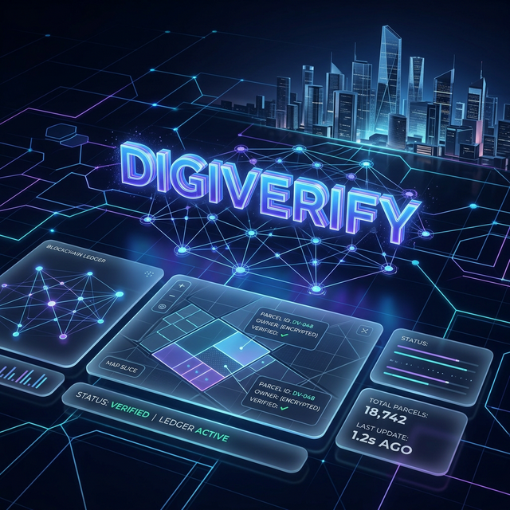
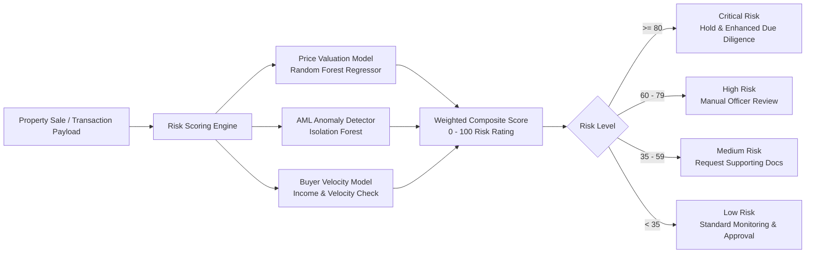

# Digiverify

<div align="center">



### **Government-Grade Trustless Land Registry & Multi-Sig Conveyance Suite**
*Next-generation digital land title tokenization, automated multi-signature escrow settlements, AI fraud risk monitoring, and tamper-proof judicial oversight on Ethereum Sepolia.*

[-627EEA?style=for-the-badge&logo=ethereum&logoColor=white)](https://sepolia.etherscan.io/)
[](https://soliditylang.org/)
[](https://nodejs.org/)
[](https://react.dev/)
[](https://www.postgresql.org/)
[](https://ipfs.tech/)
[](https://scikit-learn.org/)
[](LICENSE)

</div>

---

## Table of Contents

- [Overview](#overview)
- [Key Features](#key-features)
- [System Architecture & Lifecycle](#system-architecture--lifecycle)
- [Smart Contract Ecosystem (Ethereum Sepolia)](#smart-contract-ecosystem-ethereum-sepolia)
- [AI & Machine Learning Risk Engine](#ai--machine-learning-risk-engine)
- [Technical Stack](#technical-stack)
- [Project Structure](#project-structure)
- [Setup & Installation](#setup--installation)
  - [Prerequisites](#prerequisites)
  - [1. Database Setup](#1-database-setup)
  - [2. Smart Contract Deployment](#2-smart-contract-deployment)
  - [3. Backend Configuration & Execution](#3-backend-configuration--execution)
  - [4. Frontend Configuration & Execution](#4-frontend-configuration--execution)
- [API Overview](#api-overview)
- [Security & Compliance](#security--compliance)
- [License](#license)

---

## Overview

Traditional land registry systems suffer from severe vulnerabilities: document forgery, fraudulent multiple sales of the same parcel, non-transparent bureaucratic delays, and slow judicial dispute resolution.

**Digiverify** solves these systemic problems by combining:
1. **ERC-721 Property Tokenization** on **Ethereum Sepolia**, minting immutable, sovereign digital land titles with cadastral boundaries and dynamic SVG deed certificates.
2. **ASBA-Style Bank Fund Blocking & Liens**, locking buyer funds securely in escrow to prevent defaults and payment fraud.
3. **Multi-Party Multi-Signature Settlement**, requiring non-repudiable wallet signatures from the Seller, Buyer, Bank Admin, and Government Registrar before deed finalization.
4. **AI-Powered Fraud & Market Risk Engine**, running Random Forest valuation with bulk land parcel economics alongside Isolation Forest AML anomaly detection and buyer income verification.
5. **Judicial Injunction & Dispute Protection**, allowing legal authorities to freeze contested titles or execute court-ordered reversals transparently on-chain.
6. **Municipal Tax & Probate Governance**, managing succession claims, inheritance transfers, and property tax clearances on-chain.
7. **Biometric Face ID Scan & Rekognition**, leveraging AWS Rekognition for liveness detection and instant citizen identity lookup.
8. **Decentralized IPFS Storage**, securing deed documents and survey maps pinned via Pinata and immutably anchored on-chain.

---

## Key Features

- **ERC-721 Digital Title Tokenization**: Land ownership is minted as a non-fungible token containing unique government parcel identifiers, cadastral survey coordinates, and document hashes.
- **3-Party Multi-Signature Escrow**: Enforces automated on-chain consensus where the Seller, Buyer, and Land Authority must each sign with cryptographic wallets before ownership transfers.
- **ASBA-Style Bank Fund Blocking**: Integrates banking fund-locking mechanisms that hold transaction funds in an account and guarantee payout only upon on-chain conveyance.
- **Autonomous Title Conveyance**: Zero manual sync needed — once all signatures and bank locks are in place, smart contracts finalize deed transfer atomically.
- **AI Fraud & Valuation Model**: Tri-engine ML assessment evaluating price deviation (with acreage bulk discounting), AML anomaly detection, and buyer velocity/income verification.
- **Judicial Emergency Freeze & Injunction**: Authorized court roles can freeze encumbered assets or execute judicial reversal orders with cryptographically verifiable case citations.
- **Municipal Tax Vault & NOC**: Tracks municipal valuations, records payments, and issues verifiable Tax Clearance NOCs directly on-chain.
- **Inheritance & Succession Protocol**: Formal probate workflows for legal heirs to stake inheritance claims with verification checkpoints and title reassignment.
- **Biometric Citizen Identity Verification**: Live camera face identification matching facial feature vectors against verified citizen biometric databases.
- **Soulbound Citizen Attestation**: On-chain cryptographic identity attestation linking citizen KYC verification status.

---

## Smart Contract Ecosystem (Ethereum Sepolia)

The smart contract suite is written in Solidity `0.8.28`, compiled with Hardhat, and deployed on the **Ethereum Sepolia Testnet** (`Chain ID: 11155111`):

| Contract | Address | Purpose |
| :--- | :--- | :--- |
| **`LandNFT`** | [`0xbCB28DC4eF6242572c0a65D1643595C582106249`](https://sepolia.etherscan.io/address/0xbCB28DC4eF6242572c0a65D1643595C582106249) | ERC-721 token representing sovereign land titles with freeze and judicial transfer hooks. |
| **`LandRegistry`** | [`0xd6e6e94c053D204Ad535Ef8f2b01A1835696e9B1`](https://sepolia.etherscan.io/address/0xd6e6e94c053D204Ad535Ef8f2b01A1835696e9B1) | Sovereign property registration, boundary specifications, and government title clearance. |
| **`SaleContract`** | [`0xA94321fA51b6F600Ef32Ab652965AC689D967b9B`](https://sepolia.etherscan.io/address/0xA94321fA51b6F600Ef32Ab652965AC689D967b9B) | 3-party multi-sig escrow settlement coordinating buyer, seller, and authority consent. |
| **`CourtOverride`** | [`0x4437904bF4cff91E91c16bB135752038d3418B8C`](https://sepolia.etherscan.io/address/0x4437904bF4cff91E91c16bB135752038d3418B8C) | High Court emergency injunctions, judicial freezes, and title rectifications with case citations. |
| **`BankLienRegistry`** | [`0x6E8953f0288820bDB77CA89eaAF6c54Ff1250300`](https://sepolia.etherscan.io/address/0x6E8953f0288820bDB77CA89eaAF6c54Ff1250300) | ASBA mortgage liens and fund-blocking controls ensuring liquidity before deed release. |
| **`InheritanceSuccession`** | [`0x712a073f1849456b13c983195a62fc79D50F52B8`](https://sepolia.etherscan.io/address/0x712a073f1849456b13c983195a62fc79D50F52B8) | Probate claims, legal heir verification, and cryptographic title re-assignment upon death. |
| **`PropertyTaxVault`** | [`0x4bC7B4A62b7a97c40Bf4F028EbF043Fb0AbB7999`](https://sepolia.etherscan.io/address/0x4bC7B4A62b7a97c40Bf4F028EbF043Fb0AbB7999) | Municipal tax ledger, annual tax assessment recording, and on-chain Tax Clearance Certificates (NOC). |
| **`CitizenIdentityRegistry`** | [`0xCaa02E5ba741c314c12563dBE2eABCd2d6c5c6a3`](https://sepolia.etherscan.io/address/0xCaa02E5ba741c314c12563dBE2eABCd2d6c5c6a3) | Soulbound KYC attestation registry verifying citizen authorization and biometric binding. |

---

## AI & Machine Learning Risk Engine

Digiverify incorporates an automated tri-factor risk engine (`model/score_api.py`) evaluating transactions in real time:



1. **Random Forest Price Valuation (30% Weight)**:
   - Evaluates listing prices against district and locality circle guidance rates.
   - Incorporates a calibrated **bulk land parcel discount curve** for acreage/large plots ($>4,000\text{ sq.ft.}$) to ensure realistic cadastral land pricing.
2. **Isolation Forest AML Detection (35% Weight)**:
   - Unsupervised outlier analysis detecting anomalous transaction values, velocity spikes, and counterparty clustering.
3. **Buyer Velocity & Income Verification (35% Weight)**:
   - Assesses purchase value against annual declared income and 90-day transaction frequency.

---

## Technical Stack

| Layer | Technologies |
| :--- | :--- |
| **Blockchain** | Solidity `0.8.28`, Hardhat, OpenZeppelin, Ethers.js `v6`, Ethereum Sepolia Testnet |
| **Backend API** | Node.js, Express `v5`, PostgreSQL (`pg`), Multer, Helmet, Axios, Dotenvx |
| **Frontend Web** | React 19, Vite, Tailwind CSS `v4`, Lucide Icons, React Router `v7`, Canvas Confetti |
| **Machine Learning** | Python 3, Scikit-Learn (Random Forest, Isolation Forest, HistGradientBoosting), Pandas, NumPy |
| **Biometrics** | AWS Rekognition (Face Verification & Liveness), Browser MediaDevices API |
| **Storage & Security** | IPFS (Pinata Cloud), JWT Authentication, bcrypt, ASBA-style Escrow |

---

## Project Structure

```
Digiverify/
├── backend/                 # Node.js Express 5 API Server
│   ├── blockchain/          # Contract abstractions & ethers.js service bindings
│   ├── config/              # PostgreSQL pool, schema.sql, and blockchain config
│   ├── controllers/         # Business logic (Auth, Property, Court, Tax, Succession, Biometric)
│   ├── events/              # Blockchain event listener & DB synchronization
│   ├── middlewares/         # JWT auth, RBAC authorization, timeout, rate-limiting
│   ├── models/              # PostgreSQL data access models
│   ├── routes/              # Express API route declarations
│   ├── services/            # Core services (Audit, ML Risk, Rekognition, Court, Tax)
│   └── utils/               # Zod validation schemas, temporary file storage, helpers
│
├── contracts/               # Hardhat Solidity Suite
│   ├── contracts/           # Solidity smart contracts
│   ├── scripts/             # Deployment and test scripts
│   ├── hardhat.config.js    # Hardhat compiler & Sepolia network configuration
│   └── deployments.json     # Deployed contract addresses & deployment metadata
│
├── frontend/                # React 19 + Vite Web Application
│   ├── public/              # Static brand assets, certificates, and icons
│   └── src/
│       ├── components/      # Reusable UI components (RiskAnalysisWidget, modals)
│       ├── context/         # AuthContext, Web3Context
│       ├── layouts/         # AdminSidebar, CitizenSidebar, Navigation layouts
│       ├── pages/
│       │   ├── Admin/       # Authority dashboards, KYC approval, revenue analytics, disputes, tax vault, succession, face scan
│       │   ├── Auth/        # Login, registration, biometric capture
│       │   └── Dashboard/   # Property management, purchase review, sales, tax vault, succession claims
│       └── services/        # Axios API clients & Web3 transaction helpers
│
└── model/                   # Machine learning risk scoring & anomaly detection engine
    ├── artifacts/           # Serialized model weights (price_model.joblib, aml_model.joblib)
    ├── price_risk.py        # Random Forest valuation & bulk land discount model
    ├── aml_risk.py          # Isolation Forest AML anomaly detector
    ├── buyer_risk.py        # Buyer velocity & income consistency engine
    ├── risk_engine.py       # Composite scoring orchestrator
    └── score_api.py         # Subprocess JSON scoring CLI interface
```

---

## Setup & Installation

### Prerequisites

- **Node.js** `>= 18.x` & **npm** `>= 9.x`
- **Python** `>= 3.10` with `venv`
- **PostgreSQL** `>= 14.x`
- **MetaMask** browser extension configured for **Ethereum Sepolia Testnet**
- Testnet Sepolia ETH (from [Google Cloud Web3 Faucet](https://cloud.google.com/application/web3/faucet/ethereum/sepolia) or [Alchemy Faucet](https://sepoliafaucet.com/))

---

### 1. Database Setup

1. Start your local PostgreSQL server.
2. Create the database:
   ```bash
   createdb digiverify
   ```
3. Initialize the database schema:
   ```bash
   psql -d digiverify -f backend/config/schema.sql
   ```

---

### 2. Smart Contract Setup

The contracts are already compiled and deployed to Ethereum Sepolia. If you wish to recompile or redeploy:

```bash
cd contracts
npm install

# Compile contracts
npx hardhat compile

# Deploy to Ethereum Sepolia
npx hardhat run scripts/deploy.js --network sepolia
```

---

### 3. Backend Configuration & Execution

1. Navigate to `backend/` and install dependencies:
   ```bash
   cd backend
   npm install
   ```

2. Create `.env` from `.env.example`:
   ```bash
   cp .env.example .env
   ```

3. Configure your environment variables in `.env`:
   - Set PostgreSQL credentials (`PGHOST`, `PGPORT`, `PGUSER`, `PGPASSWORD`, `PGDATABASE`).
   - Set `SEPOLIA_RPC_URL` (e.g. from Alchemy or Infura).
   - Set `SIGNER_PRIVATE_KEY` for the backend authority wallet.
   - Set `PINATA_API_KEY` and `PINATA_SECRET_API_KEY` for IPFS uploads.
   - Set AWS credentials for facial recognition (`AWS_ACCESS_KEY_ID`, `AWS_SECRET_ACCESS_KEY`, `AWS_REGION`).

4. Start the backend server:
   ```bash
   npm run dev
   ```
   *The backend API will start at `http://localhost:5000`.*

---

### 4. Frontend Configuration & Execution

1. Navigate to `frontend/` and install dependencies:
   ```bash
   cd frontend
   npm install
   ```

2. Start the Vite development server:
   ```bash
   npm run dev -- --host
   ```
   *The application will be accessible at `http://localhost:5173`.*

---

## API Overview

| Route Group | Path Prefix | Description |
| :--- | :--- | :--- |
| **Authentication** | `/api/auth` | User registration, login, wallet binding, JWT token renewal. |
| **Properties** | `/api/properties` | Property registration, survey approval, deed hashes, parcel search. |
| **Sales & Escrow** | `/api/sales` | Multi-sig sale initiation, buyer signing, automated final settlement. |
| **Banking (ASBA)** | `/api/bank` | Fund block creation, bank admin confirmation, lien status. |
| **Biometrics** | `/api/biometric` | Live facial verification, face scan citizen lookup via AWS Rekognition. |
| **Municipal Tax** | `/api/tax` | Tax assessments, property tax clearance, on-chain Tax NOC vault. |
| **Succession & Probate** | `/api/succession` | Legal heir claims, court decree verification, inheritance title transfers. |
| **Court & Injunctions** | `/api/admin/property` | Judicial freeze orders, reverse freezes, forced judicial transfers. |
| **Admin & Authority** | `/api/admin` | KYC attestation, survey review, dispute center, revenue analytics. |
| **Risk & Analytics** | `/api/risk` | ML-driven transaction risk scoring, circle valuations, and anomaly detection. |

---

## Security & Compliance

- **Role-Based Access Control (RBAC)**: Smart contracts implement OpenZeppelin `AccessControl` segregation (`DEFAULT_ADMIN_ROLE`, `AUTHORITY_ROLE`, `BANK_ROLE`, `COURT_ROLE`).
- **Cryptographic Multi-Signature Settlement**: Eliminates unilateral transfers by requiring explicit on-chain authorizations from buyer, seller, bank, and regulatory authority.
- **Automatic Fallback Reconciliation**: The backend guarantees that database status and blockchain token ownership stay 100% consistent across all transactions.
- **Cryptographic Document Integrity**: Deed documents and boundary surveys are hashed with SHA-256 before upload and stored immutably on IPFS.
- **Judicial Intervention**: Protects against fraud and lost keys through designated court injunction and title deed force-transfer capabilities with automated unfreeze safeguards.

---

## License

This project is licensed under the **Apache License, Version 2.0**. See the [LICENSE](LICENSE) file for full details.

---

<div align="center">
  <sub>Built by <b>Team Desapphire</b></sub>
</div>
