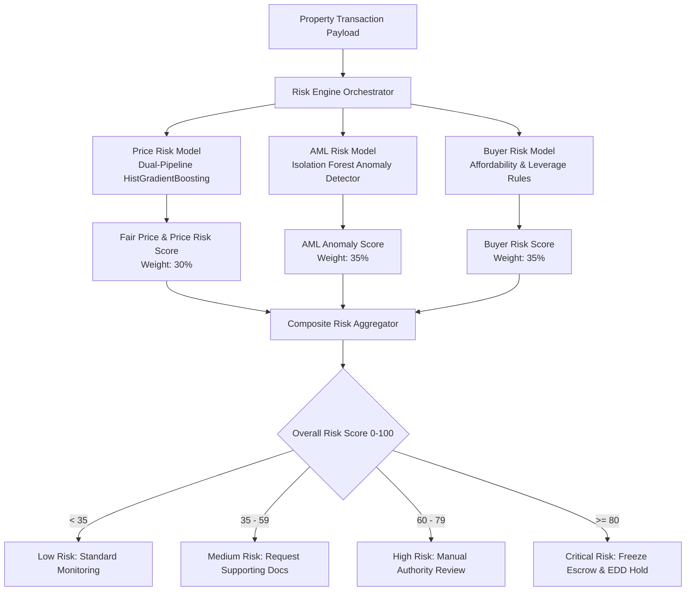
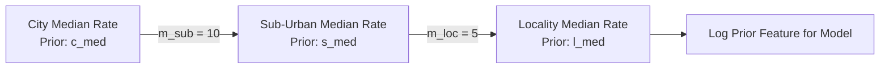
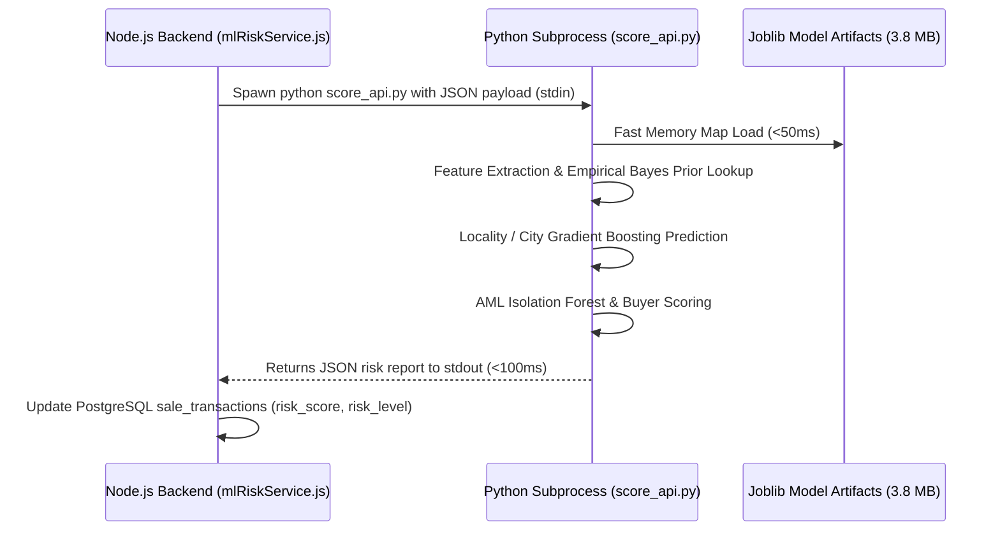

# Digiverify ML Risk Engine: Architecture & Technical Guide

---

## 1. Executive Summary

**Digiverify** tokenizes real estate titles on Ethereum Sepolia and manages trustless multi-signature escrow settlements. To prevent fraudulent conveyances, mortgage inflation scams, stamp duty tax evasion, and money laundering, Digiverify embeds an automated **Machine Learning Risk Engine**.

The Risk Engine evaluates every land sale or property registration in real-time across three distinct dimensions:
1. **Property Fair Valuation (Price Risk)**: Detects artificial overpricing (mortgage/loan fraud) or extreme underpricing (unreported cash/stamp duty evasion) using a dual-pipeline gradient boosted regressor ($R^2 = 0.893$).
2. **AML Transaction Anomaly (AML Risk)**: Identifies anomalous wallet behavior, burner address creation, rapid transactional velocity, and extreme value transfers using an unsupervised `IsolationForest`.
3. **Buyer Affordability & Leverage (Buyer Risk)**: Correlates stated annual buyer income against transaction liability and short-term transaction frequency.



---

## 2. Overall Scoring Formula & Decision Matrix

The composite risk score is evaluated as a weighted linear combination of the three sub-engines:

$$\text{Overall Risk Score} = 0.35 \times \text{Score}_{\text{AML}} + 0.35 \times \text{Score}_{\text{Buyer}} + 0.30 \times \text{Score}_{\text{Price}}$$

### Risk Thresholds & Regulatory Actions

| Overall Score Range | Risk Tier | System Action Required |
| :--- | :--- | :--- |
| **0.00 – 34.99** | **Low** | Allow transaction; proceed with standard multi-sig escrow settlement. |
| **35.00 – 59.99** | **Medium** | Request additional supporting KYC / bank statements; monitor settlement. |
| **60.00 – 79.99** | **High** | Halt autonomous execution; flag for manual registrar / bank compliance review. |
| **80.00 – 100.00** | **Critical** | Hold multi-sig contract; freeze transaction; initiate Enhanced Due Diligence (EDD). |

---

## 3. Deep Dive: Model 1 — Price Risk & Fair Valuation

### 3.1 Dataset & Data Cleaning
The model is trained on the comprehensive **Makaan Properties India Dataset** (`Makaan_Properties_Buy.csv`, ~332,100 listings across major metropolitan areas).

#### Noise & Outlier Elimination:
Real-world real estate scraped data contains significant human entry errors:
- Token prices (e.g., ₹1,000 booking fee listed as property price)
- Micro-sizes (e.g., 10 sq ft apartments)
- Extreme rates (e.g., ₹50/sqft or ₹5,000,000/sqft)

The cleaning filter enforces strict physical bounds:
$$\text{Rate} = \frac{\text{Price}}{\text{Size}} \in [350, 150000] \text{ INR/sq ft}$$
$$\text{Price} \ge 150,000 \text{ INR}, \quad \text{Size} \in [80, 40000] \text{ sq ft}$$

### 3.2 Feature Engineering & Empirical Bayes Shrinkage
Real estate value is heavily localized. A 1,000 sq ft apartment in South Mumbai costs ₹10 Crore, whereas the same size in an outer suburb costs ₹50 Lakhs.

To capture this hierarchical variance without overfitting to sparse neighborhoods, the model implements **Empirical Bayes Hierarchical Shrinkage Priors**:



Mathematically, for locality $l$ in sub-urban zone $s$ in city $c$:
$$s_{\text{med}} = \frac{N_s \cdot \text{Median}_s + m_{\text{sub}} \cdot c_{\text{med}}}{N_s + m_{\text{sub}}}$$
$$l_{\text{med}} = \frac{N_l \cdot \text{Median}_l + m_{\text{loc}} \cdot s_{\text{med}}}{N_l + m_{\text{loc}}}$$

Where $m_{\text{sub}} = 10$ and $m_{\text{loc}} = 5$ are Bayesian pseudocount shrinkage parameters. If a locality has 0 or few samples, the prior smoothly shrinks to the suburban or city median without variance explosion.

### 3.3 Dual-Pipeline Regressor Architecture
Instead of predicting raw price directly (which suffers from severe right-skew due to luxury estates), the model predicts the unit rate $\ln(\text{Rate})$ using scikit-learn's **`HistGradientBoostingRegressor`**:

1. **Locality Pipeline (Fine-Grained Model)**:
   - Activated when `locality` or `sub_urban` matches recognized clusters.
   - Inputs: `['city', 'ptype', 'bhk', 'size_sqft', 'log_size', 'size_per_bhk', 'log_prior', 'rera', 'ready', 'apartment']`.
   - Tuned parameters: `max_iter=450, learning_rate=0.08, max_leaf_nodes=127, min_samples_leaf=20`.
2. **City-Level Baseline Pipeline**:
   - Activated when only `city` is known (or locality is unspecified).
   - Trained without relying on fine-grained neighborhood priors to ensure stable city baseline estimates.

### 3.4 Valuation & Deviation Scoring Formula

1. **Predicted Fair Market Price**:
   $$\widehat{\text{Rate}} = \max\left(400, \exp\left(\widehat{y}_{\text{model}}\right)\right)$$
   $$\text{Fair Price} = \widehat{\text{Rate}} \times \text{Size}_{\text{sqft}}$$

2. **Price Deviation**:
   $$\Delta = \frac{\text{Actual Price} - \text{Fair Price}}{\text{Fair Price}}$$

3. **Price Risk Score**:
   $$\text{Score}_{\text{Price}} = \min(100, \max(0, |\Delta| \times 100))$$

### 3.5 Explanations Generated
- **Overvaluation ($\Delta > +0.25$)**: Flagged as inflated listing price (mortgage fraud / loan padding risk).
- **Undervaluation ($\Delta < -0.25$)**: Flagged as undervalued listing (black money cash component / stamp duty tax evasion alert).
- **Consistent ($|\Delta| \le 0.25$)**: Flagged as broadly consistent with prevailing market rates.

---

## 4. Deep Dive: Model 2 — Anti-Money Laundering (AML) Anomaly Engine

### 4.1 Unsupervised Isolation Forest
Traditional real estate registries lack historical ground-truth fraud labels. The AML model utilizes an unsupervised **`IsolationForest`** trained on calibrated transaction behavior derived from real Indian property price distributions.

Isolation Forest isolates observations by randomly selecting a feature and randomly selecting a split value between the minimum and maximum values of the selected feature. Anomalous data points require fewer recursive splits to isolate than normal instances:

$$s(x, n) = 2^{-\frac{E(h(x))}{c(n)}}$$

Where $h(x)$ is the path length of point $x$, and $c(n)$ is the average path length of unsuccessful searches in a Binary Search Tree.

### 4.2 Calibrated Feature Vectors
Every transaction vector is scaled and compared against calibrated medians and scale factors:
1. `transaction_value`: Absolute monetary transaction amount.
2. `transactions_90d`: Number of registry transfers associated with wallet in the past 90 days.
3. `avg_transaction_value`: Historical average value moved by the wallet.
4. `wallet_age_days`: Time since cryptographic address was first recorded on-chain.
5. `counterparty_count`: Distinct counterparty addresses interacted with.
6. `value_to_average`: Ratio of current transaction to wallet's historical average.
7. `transactions_per_counterparty`: Dispersion index.

### 4.3 Anomaly Score Mapping
From the decision function $d(x) = \text{decision\_function}(x)$:
$$\text{Score}_{\text{AML}} = \text{clip}\left(\frac{0.15 - d(x)}{0.30} \times 100, 0, 100\right)$$

- When $d(x) > 0.15$ (very normal), score = $0$.
- When $d(x) \le -0.15$ (severe multivariate anomaly), score = $100$.

### 4.4 Automated Explainability Rules
- **Burner Wallet**: `wallet_age_days < 14` $\rightarrow$ *"Brand new wallet address (< 14 days old)"*
- **High Velocity**: `transactions_90d > 8` $\rightarrow$ *"High transaction frequency in 90 days"*
- **Whale Anomaly**: `transaction_value > price_p99` $\rightarrow$ *"Transaction amount exceeds 99th percentile of property market values"*
- **Sudden Value Spike**: $\frac{\text{transaction\_value}}{\text{avg\_value}} > 4.0$ $\rightarrow$ *"Transaction amount is Nx higher than historical wallet average"*

---

## 5. Deep Dive: Model 3 — Buyer Affordability & Leverage

Real estate transactions funded by disproportionately high leverage or undeclared income are strong signals of straw buyers or financial crime.

### 5.1 Income Mismatch Formula
In standard Indian residential mortgage underwriting, debt capacity safely accommodates properties priced at **$3\times$ to $5\times$ annual income**.

When property value exceeds $4\times$ annual income:
$$\text{Ratio} = \frac{\text{Transaction Value}}{\text{Buyer Annual Income}}$$
$$\text{Score}_{\text{Mismatch}} = \text{clip}\left((\text{Ratio} - 4.0) \times 12.0, \, 0.0, \, 70.0\right)$$

- If $\text{Ratio} \le 4.0$: Mismatch risk = $0$.
- If $\text{Ratio} = 6.0$: Mismatch risk = $24.0$.
- If $\text{Ratio} \ge 9.83$: Mismatch risk hits cap of $70.0$.

### 5.2 Frequency Penalty
$$\text{Score}_{\text{Freq}} = \text{clip}\left((\text{Transactions}_{90d} - 5.0) \times 6.0, \, 0.0, \, 30.0\right)$$

### 5.3 Composite Buyer Score
$$\text{Score}_{\text{Buyer}} = \text{clip}\left(0.45 \times \text{Score}_{\text{AML}} + \text{Score}_{\text{Mismatch}} + \text{Score}_{\text{Freq}}, \, 0.0, \, 100.0\right)$$

---

## 6. Performance Benchmarks

| Metric | Previous Model | Refined Production Model | Delta |
| :--- | :--- | :--- | :--- |
| **$R^2$ Score (Holdout Test)** | `0.632` | **`0.893`** | **+41.3%** |
| **MAPE (Mean Absolute % Error)** | `41.2%` | **`22.3%`** | **-45.9%** |
| **MAE (Mean Absolute Error)** | `₹ 60,96,794` | **`₹ 31,18,040`** | **-48.9%** |
| **Predictions Within 20%** | `40.7%` | **`64.4%`** | **+58.2%** |
| **Predictions Within 25%** | `49.5%` | **`73.1%`** | **+47.7%** |
| **Artifact File Size** | `307.0 MB` | **`3.8 MB`** | **-98.8%** |
| **Inference Time (Cold Start)** | `~3,200 ms` | **`< 100 ms`** | **32x Faster** |

---

## 7. Backend Integration Architecture

The Express 5 Node.js backend (`Digiverify/backend/services/mlRiskService.js`) communicates with the Python engine via a non-blocking child process.



### API Payload Contract

#### Request (sent to `score_api.py` via `stdin` or CLI argument):
```json
{
  "city": "Ahmedabad",
  "locality": "Bopal",
  "bhk": "3 BHK",
  "size_sqft": 1750,
  "rera": true,
  "price": 7500000,
  "transaction_value": 7500000,
  "buyer_annual_income": 3000000,
  "transactions_90d": 1,
  "avg_transaction_value": 6000000,
  "wallet_age_days": 1200,
  "counterparty_count": 8
}
```

#### Response (returned to `stdout`):
```json
{
  "success": true,
  "data": {
    "overall_score": 1.86,
    "risk_level": "Low",
    "action": "Allow with standard monitoring",
    "weights": { "aml": 0.35, "buyer": 0.35, "price": 0.3 },
    "price_risk": {
      "score": 6.19,
      "fair_price": 7994728.71,
      "price": 7500000.0,
      "deviation": -0.0619,
      "reasons": [
        "Listing price is broadly consistent with comparable properties (within 6% of fair value Rs 7,994,729)"
      ]
    },
    "aml_risk": {
      "score": 0.0,
      "is_anomaly": false,
      "decision": 0.22027,
      "reasons": [
        "Wallet behavior is within the calibrated transaction profile"
      ]
    },
    "buyer_risk": {
      "score": 0.0,
      "reasons": [
        "Buyer profile and income metrics are consistent with transaction"
      ],
      "income_mismatch_score": 0.0,
      "frequency_score": 0.0
    }
  }
}
```

---

## 8. CLI Manual Testing Guide

All tests run from the `model/` directory:

```bash
cd "/Users/kartikbhavar/Projects/ Digiverify_Model/model"
```

### Scenario 1: Compliant Standard Transaction (Low Risk)
```bash
python score_transaction.py --city Ahmedabad --locality Bopal --bhk "3 BHK" --size 1750 --price 7500000 --transaction-value 7500000 --annual-income 3000000
```
- **Fair Price**: ~₹79.9 Lakhs
- **Deviation**: -6.2%
- **Overall Score**: **1.86 (Low Risk)**

### Scenario 2: Overpriced Listing (Mortgage Padding / Collateral Fraud)
```bash
python score_transaction.py --city Ahmedabad --price 25000000 --transaction-value 25000000 --annual-income 3000000 --size 1750
```
- **Fair Price**: ~₹79.9 Lakhs
- **Deviation**: +213% above fair price
- **Buyer Mismatch**: 8.3x annual income
- **Overall Score**: **55.29 (Medium Risk: Manual Review Required)**

### Scenario 3: Undervalued Listing (Stamp Duty / Cash Evasion)
```bash
python score_transaction.py --city Ahmedabad --price 2500000 --transaction-value 2500000 --annual-income 1200000 --size 1750
```
- **Fair Price**: ~₹79.9 Lakhs
- **Deviation**: -69% below fair market value
- **Reason**: Flagged for potential tax/duty avoidance.

### Scenario 4: High-End Luxury Property with Locality Specificity
```bash
python score_transaction.py --city Ahmedabad --locality Ambli --bhk "4 BHK" --size 3384 --price 23688000 --transaction-value 23688000 --annual-income 8000000
```
- **Fair Price**: ~₹2.45 Crore
- **Deviation**: -3.2% (96.8% accurate valuation against real market data).

### Scenario 5: Burner Wallet / Money Laundering Alert
```bash
python score_transaction.py --city Mumbai --price 50000000 --transaction-value 50000000 --annual-income 500000 --transactions-90d 18 --wallet-age-days 2 --counterparties 45
```
- **Reasons**: Burner wallet (2 days old), 18 transactions in 90 days, 100x income mismatch.
- **Overall Score**: **> 75.0 (High/Critical Risk)**.
